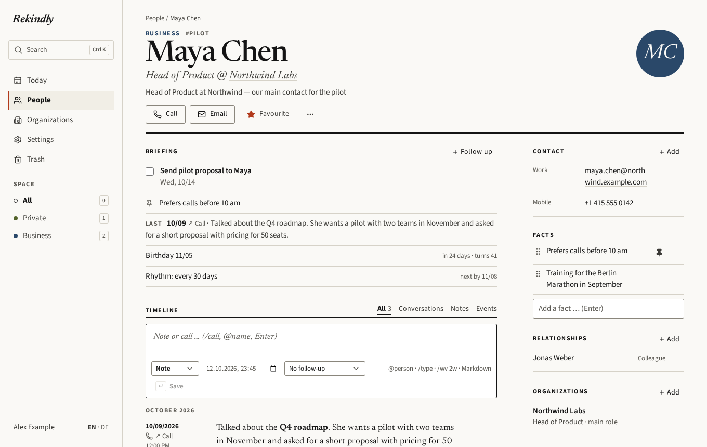
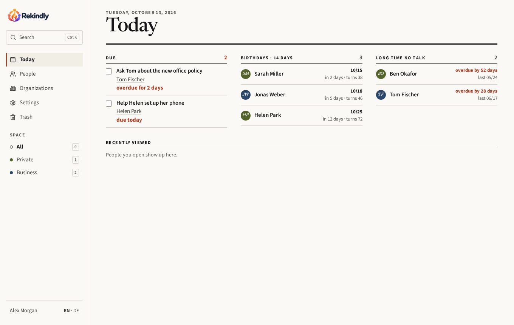
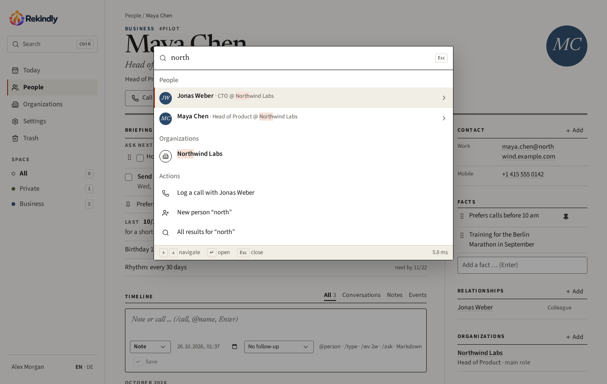
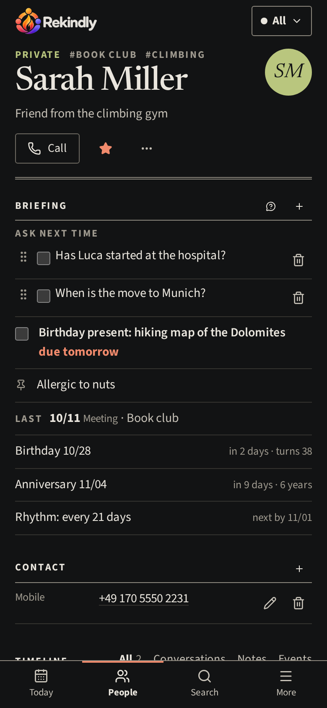
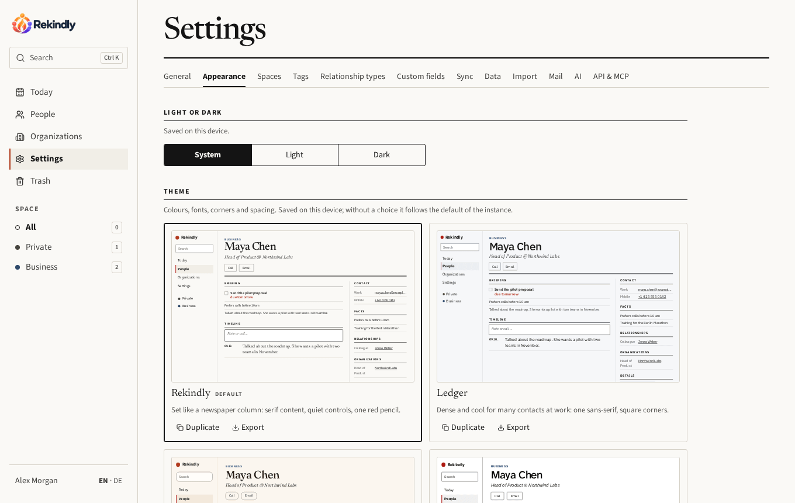

<p align="center">
  <picture>
    <source media="(prefers-color-scheme: dark)" srcset="docs/brand/rekindly-subtitle-dark.png" />
    
  </picture>
</p>

# Rekindly

**A self-hosted memory for the people in your life.**

Rekindly keeps track of the people you know — who someone is, what matters to them,
what you talked about last time, what you promised to follow up on — and gives you a
short briefing before a call or meeting. For friends and family as much as for
clients and colleagues, kept apart in separate spaces.

One person per instance, on purpose (several people run one instance each, see
[docs/deployment.md](docs/deployment.md#several-people)), one Docker container, SQLite. Your data stays on your
server: no telemetry, no external calls except the services you configure.

> **Status: 0.x, early release.** It is used daily, but expect changes. Export and
> encrypted automatic backups are built in.



## Features

- **People and organizations** — names, contact details, addresses, photo, birthday,
  how you met, tags, custom fields; organizations with departments and sites.
- **Briefing** — open follow-ups, pinned facts, the last conversation, birthday and
  your keep-in-touch rhythm at a glance.
- **Timeline** — notes, calls, meetings and messages in Markdown, linked to everyone
  involved; quick entry with `/call`, `@name` and follow-ups like `/wv 2w`.
- **Today** — due follow-ups, upcoming birthdays and people you have not talked to
  for too long.
- **Search everything** — names, companies, roles, facts, notes, contact details;
  `Müller` = `Mueller` = `Muller`; command palette with `⌘K` / `Ctrl+K`.
- **Spaces** — keep private and business apart (or add your own).
- **iPhone and other address books** — two-way CardDAV sync; calendar subscription
  for birthdays and follow-ups.
- **Import** — vCard, CSV (Google, Outlook) and **Monica** (JSON export or API), with a
  preview, duplicate detection and undo; find and merge duplicates later.
- **Backups** — full export (JSON), vCard export, and nightly encrypted backups to
  WebDAV (e.g. Nextcloud) or S3-compatible storage.
- **Optional AI** — summarize a briefing, suggest facts from a note, ask questions
  in plain language. Local models (LM Studio, Ollama) or a cloud provider; only spaces
  you release are ever sent.
- **API and MCP** — documented REST API with API tokens, and an MCP server: ask
  Claude “what do I know about Maya?”.
- **Mail** — a daily summary of what is due, and optional sign-in codes by email.
- **Themes and layouts** — six built-in themes (light and dark) and five layouts for
  the person page; build your own in the app and share it as a file.
- **Private by design** — one account, passkeys, light and dark mode, English and
  German, works on the phone.

| Today                                | Search                                 | Phone                                                             |
| ------------------------------------ | -------------------------------------- | ----------------------------------------------------------------- |
|  |  |  |



## Quick start

```sh
docker run -d --name rekindly -p 3000:3000 -v rekindly-data:/data \
  -e PUBLIC_URL=http://localhost:3000 ghcr.io/dddanny79/rekindly:latest
```

Open <http://localhost:3000> and create your account. That's it.

For a real installation behind HTTPS (needed for passkeys and the iPhone), with
Docker Compose, Coolify or a reverse proxy, see **[docs/deployment.md](docs/deployment.md)**.

## Coming from Monica?

Rekindly is a fresh take on the same idea — and imports your Monica data:

1. In Monica: **Settings → Export → Export to Json** (or create an API token).
2. In Rekindly: **Settings → Import**, choose `monica.json` (or “Fetch from Monica”).
3. Check the preview and import. Notes, calls, activities, reminders, relationships,
   tags and photos come along; people who already exist here (e.g. synced from your
   phone) are completed instead of duplicated. You can undo the whole import.

Details: [docs/import.md](docs/import.md#monica).

## Documentation

| Topic                                                        |                                                       |
| ------------------------------------------------------------ | ----------------------------------------------------- |
| Installation, Docker, Coolify, reverse proxy, server backups | [deployment.md](docs/deployment.md)                   |
| iPhone / CardDAV sync, calendar subscription                 | [carddav.md](docs/carddav.md)                         |
| Import (vCard, CSV, Monica) and duplicates                   | [import.md](docs/import.md)                           |
| Export, restore, automatic backups                           | [export.md](docs/export.md)                           |
| Mail: daily summary, sign-in codes (2FA)                     | [mail.md](docs/mail.md)                               |
| AI features                                                  | [ai.md](docs/ai.md)                                   |
| API, tokens, MCP for Claude                                  | [api.md](docs/api.md) — live reference at `/api/docs` |
| Themes, layouts, the theme file format                       | [themes.md](docs/themes.md)                           |

## Configuration

All configuration is via environment variables; see [`.env.example`](.env.example).

| Variable       | Default                | Description                                             |
| -------------- | ---------------------- | ------------------------------------------------------- |
| `PUBLIC_URL`   | required in production | Address the app is opened at (passkeys, secure cookies) |
| `DATA_DIR`     | `/data` in production  | Database and files                                      |
| `PORT`         | `3000`                 | Port of the server                                      |
| `HOST`         | all (IPv6 + IPv4)      | Interface the server binds to                           |
| `TZ`           | `UTC`                  | Time zone                                               |
| `APP_SECRET`   | `DATA_DIR/secret.key`  | Key for stored backup credentials                       |
| `SMTP_HOST` …  | —                      | Mail server, see [docs/mail.md](docs/mail.md)           |
| `TRUST_PROXY`  | `false`                | `true` behind a reverse proxy                           |
| `LOG_LEVEL`    | `info`                 | `error`, `warn`, `info`, `debug`                        |
| `WEB_PORT`     | `5173`                 | Port of the Vite dev server (development only)          |
| `WEB_DIST_DIR` | `apps/web/dist`        | Built web app served by the server                      |

## Maintenance

Command-line tools of the server (in the container: `node dist/cli.js <command>`;
in development: `pnpm --filter @app/server cli <command>`):

| Command          | Purpose                                                           |
| ---------------- | ----------------------------------------------------------------- |
| `reset-password` | Set a new account password and sign out all sessions              |
| `disable-2fa`    | Switch off sign-in codes by email (when mail does not arrive)     |
| `reindex`        | Rebuild the full-text search index (normally kept current itself) |
| `backup [file]`  | Consistent copy of the database while the app runs                |

Deleted data goes to the trash and stays restorable for 30 days; the server purges
older items at start and then once a day.

## Contributing

Bug reports, ideas, translations and pull requests are welcome — see
[CONTRIBUTING.md](CONTRIBUTING.md). Security issues: [SECURITY.md](SECURITY.md).

Built with TypeScript, Hono, SQLite (Drizzle), React, Vite and Tailwind.

## License

[GNU Affero General Public License v3.0 or later](LICENSE). You may use, change and
share Rekindly freely; if you offer a modified version as a service to others, you
have to make its source code available to them.
